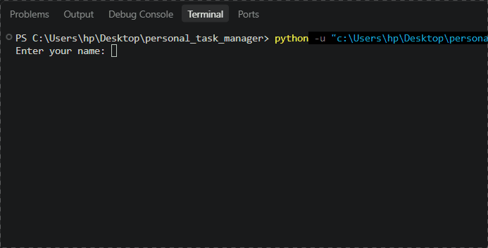

# Personal Task Manager

  
Personal Task Manager is a Python project that helps users manage their daily tasks.

## Table of Contents
- [Features](#features)
- [Project Structure](#project-structure)
- [Requirments](#requirments)
- [Installation](#installation)
- [Usage](#usage)
- [Example Output](#example-output)
- [Screenshot](#screenshot)
- [Roadmap](#roadmap)
- [Author](#author)

## Features

- Add new tasks.
- View saved tasks.
- Save tasks in a file.
- Admin mode.
- set task priority to high, medium, or low.

## Project Structure
```
C:.
|   .env.example
│   .gitignore
│   main.py
│   README.md
│   requirements.txt
│   tasks.py
```
## File Description

| file | description |
| --- | --- |
| `main.py` | runs the main program |
| `tasks.py` | contains functions for managing tasks |
| `requirements.txt` | lists the python packages required to run the project |
| `.gitignore` | specifies files and folders that git should ignore |
| `.env.example` | provides an example of the enviroment variables needed for the project |
| `README.md` | contains the project documentation |

## Requirements

- Python 3
- python-dotenv

## Installation

1. open a terminal in the project folder
2. check that python is installed:
```bash
 python --version
```
3. install the pyhton packages:
  ```bash
  pip install -r requirments.txt
  ```


## Usage
1. Open a terminal in the project folder
2. Run the program
3. Enter your name
4. write your task
5. Enter done 
6. and see your task

## Example Output
```txt
Enter your name: elina
Welcome elina
please enter ypur task(if you don't want to enter any task(done)) :do my homework
please enter ypur task(if you don't want to enter any task(done)) :done
Enter a task: 
- do my homework
- done
```

## Screenshots


## Demo


## Roadmap

- [x] Create the basic project
- [x] Add task management
- [x] save tasks to file
- [x] set up git and github
- [x] create project documentation
- [x] Add task priority
- [ ] validation task inputs
- [ ] improve error handling
  
## Author
creat by [elina](https://github.com/elinarafiei-rs)